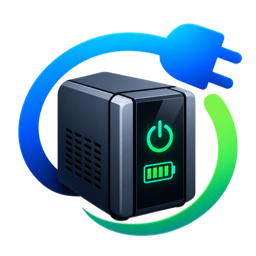
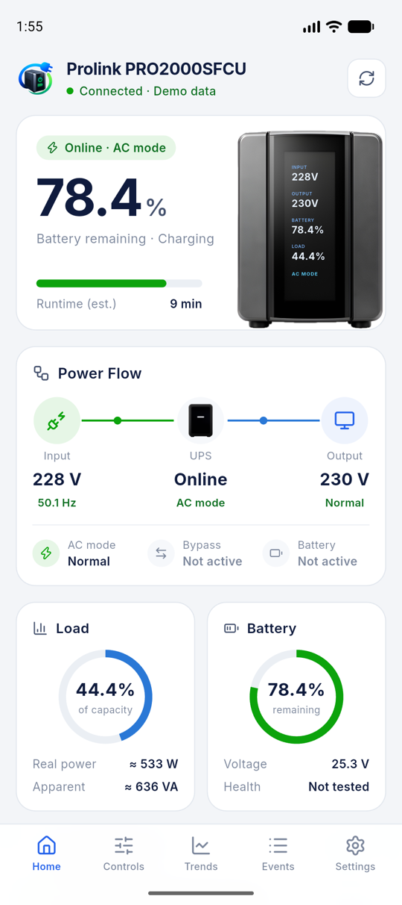
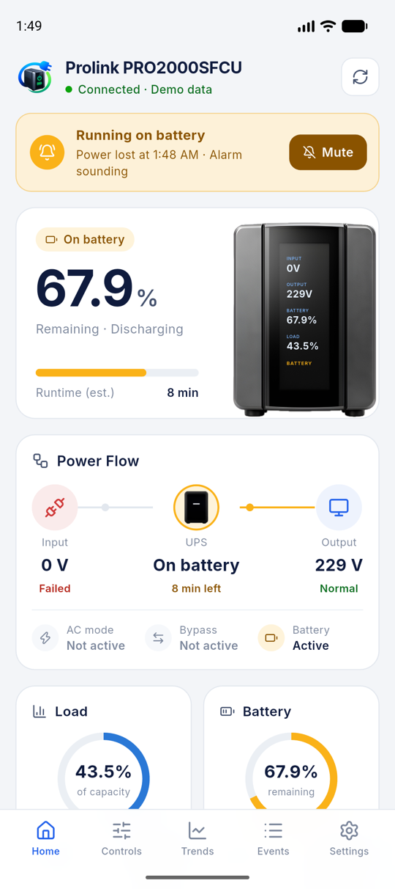
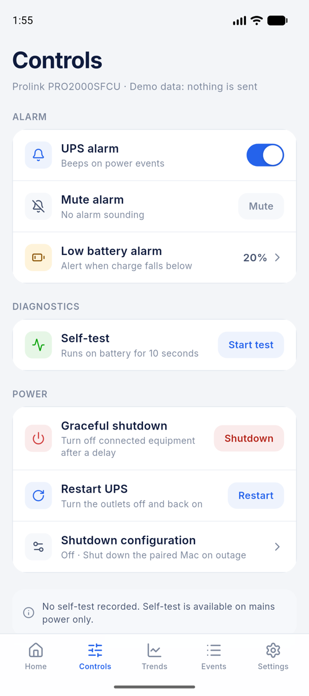
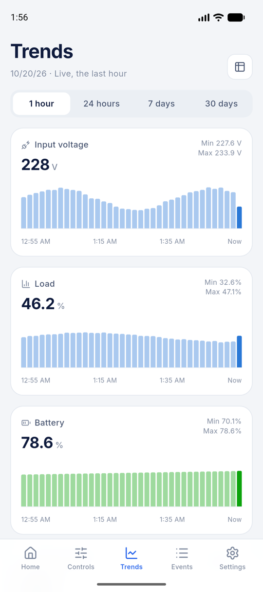
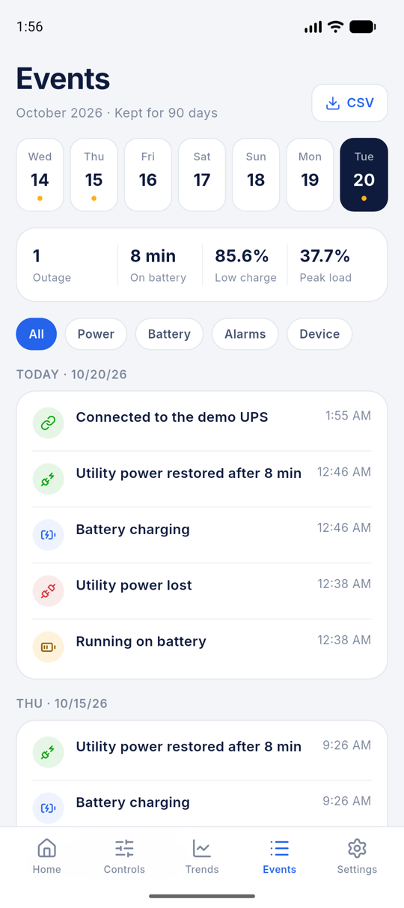
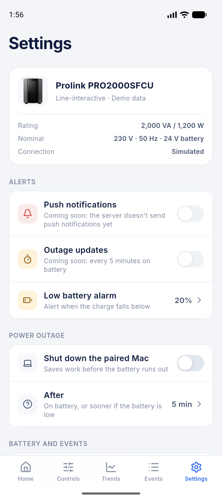

<p align="center">
  
</p>

<h1 align="center">PowerPilot for Android and iOS</h1>

<p align="center">
  Watch and control your UPS from your phone, from anywhere.
</p>

PowerPilot's phone app, for USB UPSes that speak the Megatec/Voltronic protocol
(e.g. the **Prolink PRO2000SFCU**). It's the mobile companion to the
[PowerPilot desktop app](https://github.com/tlmanz/PowerPilot) and the
[PowerPilot hardware](https://github.com/tlmanz/PowerPilotHardware): it reads a
UPS through your own `powerpilot-server`, so it works away from home too.

<table>
  <tr>
    <td align="center"><br><sub>Home</sub></td>
    <td align="center"><br><sub>During a power cut</sub></td>
    <td align="center"><br><sub>Controls</sub></td>
  </tr>
  <tr>
    <td align="center"><br><sub>Trends</sub></td>
    <td align="center"><br><sub>Events</sub></td>
    <td align="center"><br><sub>Settings</sub></td>
  </tr>
</table>

The screenshots use the built-in demo (see [Try it without a server](#try-it-without-a-server)).

## What it does

| Screen | |
|---|---|
| **Home** | Battery charge and estimated runtime, the UPS's own display, the power flow from mains through the UPS to your equipment, load and battery gauges, and the latest events. During a power cut, a banner shows when power was lost, with **Mute** for the alarm. |
| **Controls** | Turn the UPS alarm on or off, mute it for the current alarm, set the low battery alarm, run the 10-second self-test, and shut the outlets down or restart them after a delay. Shutdown and restart always ask first. |
| **Trends** | Input and output voltage, load and battery, over the last hour, 24 hours, 7 days or 30 days. Tap a bar to read it. Temperature appears for a UPS that reports it. |
| **Events** | A week at a glance, each day's outages, time on battery, lowest charge and peak load, filters, and a CSV export through the share sheet. |
| **Settings** | The UPS's ratings, the low battery alarm, shutting down the paired Mac, battery capacity for the runtime estimate, how long logs are kept, and the server. |

Readings are the same as the desktop app's: voltages, load and status from the
UPS, charge with ViewPower's formula, and runtime from PowerPilot's own model.
Not yet: push notifications, which need the server's FCM support first.

## How it connects

```
UPS ──USB──▶ ESP32 bridge, or PowerPilot on a computer (Publish mode)
                 │
                 └──▶ powerpilot-server (your VPS) ◀──HTTPS── this app
```

- **The app talks only to `powerpilot-server`,** over HTTPS with a bearer
  token. It never talks to the UPS or the MQTT broker directly.
- **Live readings** arrive as a server-sent event stream. In the background the
  app stops streaming, and it loads the full state again on return.
- **Commands** (alarm, self-test, shutdown) go through the server, which checks
  them with PowerPilot's rules before the device runs them.

### Pairing

1. On the server's admin page (`ssh -L 8081:localhost:8081 <vps>`, then
   `http://localhost:8081`), create a **phone** token. It's shown once, as a QR
   code and a link.
2. In the app, **Scan QR code**, or **Paste a pairing link**:
   `powerpilot://pair?url=https://ups.example.com&token=…&device=home`.
3. The app checks the token by listing the server's UPSes, then keeps the
   address and token in the Keychain (iOS) or Keystore (Android).

The server address must be `https`. **Settings → Unpair this phone** forgets
both; revoke the token on the admin page too.

### Try it without a server

**Try with demo data** on the pairing screen runs a simulated UPS: it cycles
between mains and a short power cut, answers every control, and makes up a
month of logs. For development, `--dart-define=DEMO=<scenario>` opens it
straight away in one scenario: `cycle`, `ac`, `battery`, `bypass` or `fault`.

## Develop

Flutter **3.44.5** (pinned in CI). iOS 15 or newer, Android 7 (API 24) or newer.

```sh
flutter pub get
flutter run --dart-define=DEMO=battery      # the demo, during a power cut
flutter run                                 # the pairing screen
flutter analyze && flutter test             # what CI checks, with the format check:
dart format --output=none --set-exit-if-changed .
```

To render every screen at the design's size, with the real fonts, into a folder:

```sh
SCREENSHOTS=/tmp/shots flutter test test/screenshots_test.dart
```

The design is `mobile.pen`; open it in [Pen](https://pen.dev). Its colors, type
and spacing are the app's tokens in `lib/ui/theme.dart`.

| Path | What |
|---|---|
| `lib/models/` | The server's JSON (`ups.dart`), and the one state every screen renders from (`ups_view.dart`) |
| `lib/data/` | The server client and its event stream, the demo, and pairing |
| `lib/state/` | The app's state: what it's paired with, and the live UPS |
| `lib/ui/` | The theme, shared widgets, the tab bar, and one file per screen |
| `test/` | Unit tests, widget tests, and the screenshot renderer |
| `tool/gen_changelog.py` | Writes each release's notes for Google Play |

## Release

A `vX.Y.Z` tag builds a signed app bundle on CircleCI and uploads it to Google
Play's internal testing track, with release notes written from the code that
changed. The versionCode is the number of release tags, so a release is:

```sh
# pubspec.yaml → version: 1.0.2
git commit -am "Release 1.0.2"
git tag v1.0.2
git push origin main v1.0.2
```

One-time setup, secrets and the checklist for another app:
[docs/release.md](docs/release.md).
